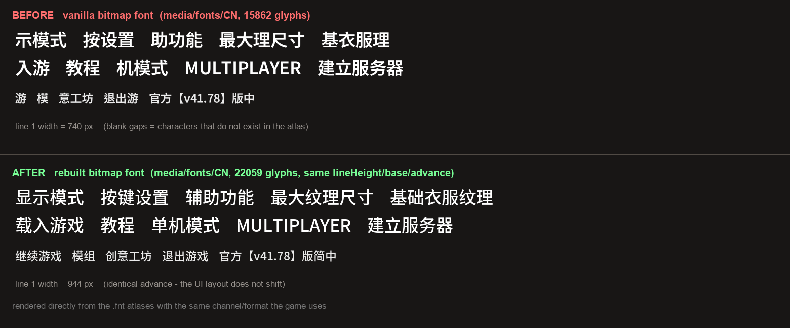

# pz-cn-fix — Project Zomboid Build 42 简体中文补全 / 中文字体重建

[](LICENSE)
[](LICENSE-DATA.md)
[](#)
[](#)
[](#)
[](#)
[](#)

[](https://github.com/BAISD007/pz-cn-fix/releases/latest)
[](https://github.com/BAISD007/pz-cn-fix/releases)
[](https://github.com/BAISD007/pz-cn-fix/commits/main)
[](https://github.com/BAISD007/pz-cn-fix/stargazers)
[](https://github.com/BAISD007/pz-cn-fix/issues)


> **非官方项目。与 The Indie Stone 无任何关联。仓库内不包含任何游戏原始文件。**
> Not affiliated with The Indie Stone. This repository contains **no game assets** —
> only our own translation data and scripts that patch the copy already installed on your PC.

Build 42 把大量新内容加入了文本表，但游戏自带的简体中文翻译仍停留在 **v41.78** 时期
（游戏底部版本行自己就写着"官方【v41.78】版简中"）。结果是：`getText()` 找不到简中条目时
**回退显示英文**；同时内置的中文界面字体是**按繁体字符集烘焙的位图字体**，简体专有字
（显、单、戏、当、键、纹、础、击、创、组…）在图集里根本不存在，会直接不显示。

本项目解决这两件事：

| 问题 | 现象 | 本项目 |
|---|---|---|
| 翻译表缺条目 | 职业/特性/选项/制作/动物界面出现英文 | 补 **1398 条**（UI 493 + IG_UI 905） |
| 字体图集缺字形 | "显示模式"显示成"示模式"、"单人游戏"显示成"人游" | 用 Noto Sans SC 重建 15 套位图字体（15862 → 22059 字形） |



*上图直接用游戏的 `.fnt` 图集渲染（不依赖系统字体）：上排是本体字体，缺的字直接不画；
下排是重建后的字体。左右宽度差来自缺失字形本身，不是排版偏移。*

## 快速开始

需要 **Windows + Python 3.9+（含 Pillow）**，以及一份已安装的 Project Zomboid Build 42。

```powershell
# 1) 补翻译（自动定位游戏目录；会先备份原文件）
python tools\apply_cn_patch.py

# 2) 重建中文字体（需要系统里有 Noto Sans SC / MiSans / 微软雅黑 任一）
python tools\build_cn_fonts.py

# 3) 想用模组形式（游戏更新后不用重跑，直接在游戏里勾选）
python tools\apply_cn_patch.py --mod
python tools\build_cn_fonts.py --mod
```

游戏目录找不到时手动指定：

```powershell
python tools\apply_cn_patch.py --game "D:\Steam\steamapps\common\ProjectZomboid"
```

## 下载

- **字体包（78 MB，不需要 Python）** →
  [Releases · latest](https://github.com/BAISD007/pz-cn-fix/releases/latest)
  已生成好的 15 套位图字体；解压后把 `media` 覆盖到游戏根目录，或解压到
  `%USERPROFILE%\Zomboid\mods\PZChineseFontPatch\` 并在游戏里启用。
- **翻译补全** → 本仓库的 `data/` + `tools/`（见上面快速开始）。
  这里**不再分发**游戏原有的文本表，而是用脚本把译文追加到你本机的副本里。

还原：

```powershell
python tools\apply_cn_patch.py --restore
python tools\build_cn_fonts.py --restore
```

## 补了哪些条目

`data/cn_ui_extra.tsv`（493 条）

- 职业与特性：Tailor→裁缝、Rancher→牧场主、Whittler→木雕师、Mason→石匠、Artisan→工匠、
  Crafty→手巧、Inventive→发明家、Wilderness Knowledge→野外知识、
  Fast/Slow Metabolism→新陈代谢快/慢
- 选项界面：Moodle Size→状态图标大小、Screen Filter→屏幕过滤、
  Pause When Focus is Lost→失去焦点时暂停、Use Physics Hit Reactions→使用物理受击反应…
- 角色创建、主菜单、模组菜单、载入界面的天气/风向/月相、
  服务器界面与设置、服装部位、80 条载入提示

`data/cn_igui_extra.tsv`（905 条）

- 技能名与说明：屠宰、雕刻、玻璃工艺、陶艺、砌石、打制石器、追踪、动物照料…
- 制作窗口：需要台面 / 必须已磨损 / 可能损坏工具 / 光线太暗 / 搜索配方 / 各种工作台
- 动物：畜牧区、鸡舍、饲料槽、动物信息与状态、屠宰钩、品种、月龄
- 钓鱼鱼饵说明、容器标题、物品分类、玩家属性面板、地图与图例、搜索模式、
  物品栏批量操作、联机管理界面、车辆型号、语音名、战争系统

## 没做什么（刻意跳过）

- 书刊/照片/漫画/杂志/涂鸦标题（2805 条）—— 纯内容标题，没有信息量
- 随机宠物名（225 条）
- 技能说明的空占位 `_Description1~10`（350 条）—— 英文原文本身是空字符串
- 调试/编辑器面板（约 700 条）—— 正常游戏看不到
- 商店/公司/职业/钥匙标签等专有名词（约 570 条）
- 制作人员名单（263 条，大量人名）
- 配方（1763 条）、印刷文本（465 条）—— 官方从 B41 时代就没翻

## 字体重建说明

- 源字体：**Noto Sans SC**（与游戏自带的 Noto Sans TC 同族，字重取 Medium）。
  脚本会依次尝试 `Noto Sans SC Medium`、`Noto Sans SC`、`MiSans-Regular`、`msyh.ttc`。
- 输出格式与游戏完全一致：AngelCode BMFont **文本** `.fnt` + 512×512
  **调色板 PNG + tRNS 透明表**（与本体图集同格式，逐张校验解码一致）
- `lineHeight` / `base` / `xadvance` 逐档沿用本体数值，**不会造成排版位移**（步进误差 ≤1px）
- 共 15 套：`Small/Medium/Large` × （顶层 + `CN/1x` ~ `CN/4x`）
- 生成物约 110 MB，**不放进仓库**；请在自己机器上生成，或从 Releases 下载

## 合规与许可

| 部分 | 许可 |
|---|---|
| 脚本 `tools/*.py` | MIT（见 `LICENSE`） |
| 翻译数据 `data/*.tsv` | CC BY 4.0（见 `LICENSE-DATA.md`） |
| 由 Noto Sans SC 生成的位图字体 | 遵循 SIL OFL 1.1（见 `THIRD-PARTY-NOTICES.md`） |

本仓库**不包含**游戏原始文件、不包含游戏本体、不包含任何破解内容。
翻译是对游戏英文文本的社区本地化，属于 PZ 社区长期存在的做法
（官方在游戏内也引导玩家到社区渠道反馈翻译问题）。

游戏文本、字体布局参数与所有商标版权归 **The Indie Stone** 所有。
如果你是版权方并认为本项目有问题，请提 issue，我们会配合处理。

## 兼容性

- 游戏版本：**Build 42**（在 42.14.1 上开发与验证）
- 与 Steam 创意工坊的汉化 mod **不要同时启用**：同一个 `UI_CN.txt` / `IG_UI_CN.txt`
  在模组之间是**整体覆盖**关系（不是逐条合并），后加载的会盖掉前者
- 翻译模组可以随时增删，不影响存档（纯文本）
